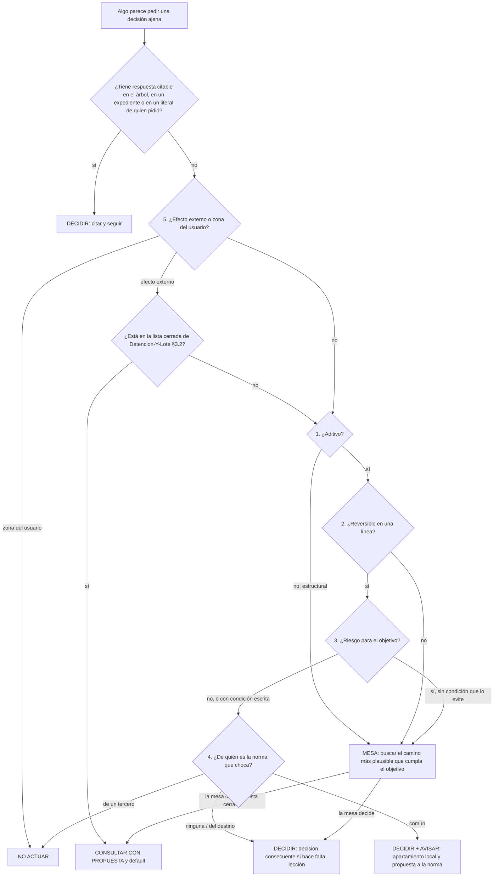

# Lógica de decisión — analizar antes de elevar: decidir, convocar una mesa o consultar con propuesta

**Alias:** Logica-De-Decision
**Naturaleza:** propio
**Tema:** Cómo un agente, una mesa o quien conduce el trabajo decide si resuelve solo, convoca una mesa o consulta a quien pidió: la prueba de materialidad (aditivo o estructural, reversible, riesgo para el objetivo, de quién es la norma, efecto externo) corrida antes de la lista cerrada de detenciones, las cinco salidas, la decisión propia del destino que se supera con una decisión consecuente, la consulta que lleva propuesta y default, la carta con intención y la decisión registrada como lección
**Consumidor:** quien conduce un trabajo encargado por otro y tropieza con algo que parece pedir una decisión ajena; quien despacha subagentes y redacta su carta; quien preside una mesa y arma el lote al cerrar; quien revisa si un trabajo preguntó lo que debía y sólo eso
**Condicion-de-carga:** antes de detenerse, escalar o armar un lote de preguntas; al redactar la carta de un subagente; al encontrar que una decisión registrada del propio destino choca con lo que se quiere hacer; al cerrar una fase con decisiones tomadas sin quien pidió: §2 para el protocolo, §3 para las reglas, §5 para los esqueletos, §6 para verificarlo
**Hereda-de:** —
**Sustituye:** —
**Compatible-con:** Rules-Base-Conocimiento.md 2.3
**Versión:** 1.0
**Estado:** Vigente
**Fecha:** 2026-10-27

---

## Índice

0. [Propósito y alcance](#0-propósito-y-alcance)
1. [Identidad del artefacto](#1-identidad-del-artefacto)
2. [Estructura: el protocolo de análisis previo](#2-estructura-el-protocolo-de-análisis-previo)
3. [Contrato de uso](#3-contrato-de-uso)
4. [Decisiones ya tomadas](#4-decisiones-ya-tomadas)
5. [Esqueletos de referencia](#5-esqueletos-de-referencia)
6. [Criterios de aceptación](#6-criterios-de-aceptación)
7. [Anti-patrones](#7-anti-patrones)
8. [Conformidad](#8-conformidad)
9. [Trazabilidad](#9-trazabilidad)
10. [Control de cambios](#10-control-de-cambios)

## 0. Propósito y alcance

Caracteriza **el análisis que se corre antes de elevar**. Su tesis: la mayoría de las preguntas que un agente
le lleva a quien pidió se contestan midiendo cinco cosas del cambio, no consultando. El objetivo de fondo es que
un subagente que carga este documento y recibe una carta con intención pueda orquestar el desarrollo sin
frenarse, y que lo poco que sí llega a la persona llegue con una recomendación y un default, para que el
desarrollo no se pare tampoco ahí.

**Terminología.**

| Término | Qué designa |
| --- | --- |
| **Elevar** | Llevarle algo a quien pidió: una detención (`Detencion-Y-Lote` §3.3) o una escalada de mesa (`Mesa` §3.6) |
| **Avisar** | Informar en el cierre lo que se decidió, sin esperar respuesta. **No es preguntar** |
| **Consultar con propuesta** | Elevar con una o dos alternativas fundamentadas, una recomendada, y el `SI NO RESPONDÉS` que rige mientras tanto |
| **Aditivo** | Un cambio que suma sin modificar ninguno de los elementos estructurales de §2, paso 1 |
| **Estructural** | Un cambio que toca un contrato público (API, formato de intercambio, esquema que otros consumen), un esquema persistido con datos, la arquitectura de capas, o **el objetivo declarado del producto** |
| **Decisión propia del destino** | Una decisión registrada (un ADR, una fila de requisitos de experiencia, una convención del repositorio) cuyo dueño es el mismo destino sobre el que se trabaja, y no una regla común a varios destinos ni de un tercero |
| **Decisión consecuente** | Una decisión registrada nueva que **supera, acota o ratifica** a una anterior, la cita y dice por qué. En un framework con ADR, es un ADR consecuente |
| **Delegación** | El literal de quien pidió que autoriza a decidir una clase de cosas, asentado en la carta o en el destino (§3.4) |
| **Zona del usuario** | Carpetas, archivos o sistemas que la persona declaró suyos aunque estén dentro del entorno de trabajo (§3.5) |
| **Lección** | El registro de una decisión tomada sin elevar, o de una elevación que resultó evitable, en la forma de §5.3 |

**Qué queda afuera:**

| Qué | Dónde vive |
| --- | --- |
| La lista cerrada de clases que se detienen, su forma y el lote | `Detencion-Y-Lote` §3.2, §3.3 y §3.5 (dueña única de la lista) |
| Los disparadores de escalada de una mesa | `Mesa` §3.6, que remite a la misma lista |
| Cómo se razona cada opción hasta su costo | `Cadena-De-Consecuencias` §2 |
| Cómo se deja de seguir un documento de conocimiento | `Excepcion-A-Un-Conocimiento` |
| El paso prescripto que falla | `Detencion-Y-Lote` §3.6 |

## 1. Identidad del artefacto

| | |
| --- | --- |
| **Qué es** | Un protocolo de cinco preguntas que se corre antes de la lista cerrada de detenciones, con cinco salidas posibles y un registro por decisión |
| **Quién lo usa** | Cualquier rol que esté por elevar, o que redacte la carta de quien podría elevar |
| **Cuándo** | Antes de cada detención, escalada o fila de lote; y al cerrar, sobre el lote entero (§3.7) |
| **Supuestos** | Hay una carta o un destino donde leer el objetivo y la delegación (§3.4). Si no la hay, rige la delegación por defecto de §3.4 |

## 2. Estructura: el protocolo de análisis previo

**La regla.** Antes de contrastar algo con la lista cerrada de `Detencion-Y-Lote` §3.2, se corren las cinco
preguntas. Cada respuesta lleva su evidencia: una cita (archivo y línea), un comando con su salida o el literal
de quien pidió. Una respuesta sin evidencia cuenta como «no sé» y se resuelve por §3.6.

1. **¿Aditivo o estructural?** Es estructural si toca alguno de estos elementos: un contrato público, un esquema
   persistido con datos, la arquitectura de capas o el objetivo declarado del producto. Si no toca ninguno, es
   aditivo.
2. **¿Reversible?** La reversión se escribe en una línea: qué se revierte y con qué. Si no entra en una línea, o
   si alcanza a terceros que ya tomaron el cambio, es irreversible (`Cadena-De-Consecuencias` §2, paso 4).
3. **¿Pone en riesgo el objetivo del proyecto?** Se lee el objetivo de la carta o del destino, se dice qué podría
   comprometer el cambio y en qué condición. Si existe esa condición, se escribe como límite de la decisión.
4. **¿De quién es la norma que choca?** Hay cuatro respuestas posibles:
   - **del propio destino**: se supera con una decisión consecuente (§3.2);
   - **común a varios destinos**: se aparta localmente y se propone el cambio a la norma (salida A+);
   - **de un tercero**: no se toca;
   - **zona del usuario**: no se toca (§3.5).
5. **¿Tiene efecto externo?** Producción, dinero, datos de personas reales, obligaciones legales o de terceros,
   credenciales y accesos (crearlos, rotarlos, revocarlos, concederlos o exponerlos), configuración de una
   organización ajena. Publicar dentro de un escenario de desarrollo declarado como tal **no** es efecto externo.
   Commitear un secreto en un repo privado propio, sin cambiar su visibilidad, tampoco lo expone: antes de
   tratarlo como efecto externo, Q0 busca la convención del destino (T10, caso C10).



**Tabla de clasificación.** Es la misma lógica del árbol, leída por fila:

| Aditivo | Reversible | Riesgo al objetivo | Norma que choca | Efecto externo | Salida |
| --- | --- | --- | --- | --- | --- |
| sí | sí | no o con condición | ninguna o del destino | no | **DECIDIR** (con decisión consecuente si hace falta) |
| sí | sí | no | común a varios destinos | no | **DECIDIR + AVISAR** (apartamiento con pregunta no bloqueante, §3.3) |
| no | sí | — | cualquiera propia | no | **MESA** |
| — | no | — | — | no | **MESA**; si la mesa no tiene salida reversible, **CONSULTAR** (`Detencion-Y-Lote` §3.7) |
| sí | sí | sí, sin condición | — | no | **MESA** |
| — | — | — | — | sí, en la lista cerrada | **CONSULTAR CON PROPUESTA** (en el momento si es credencial o paso prescripto) |
| — | — | — | de un tercero o zona del usuario | — | **NO ACTUAR**: se propone, no se toca |

## 3. Contrato de uso

La parte normativa es §6; esta sección describe la conducta que §6 verifica.

### 3.1 Las cinco salidas

| Salida | Qué hace | Bloquea |
| --- | --- | --- |
| **DECIDIR** | Resuelve, registra la lección (§5.3) y sigue | No |
| **DECIDIR + AVISAR** | Resuelve y sigue. En el cierre, un apartado propio con lo decidido, su impacto operativo y, si es un apartamiento, la pregunta «¿lo aceptás o volvemos a la norma?», mientras rige el apartamiento | No |
| **MESA** | Convoca una mesa (`Mesa-De-Expertos-A-Pedido`) con el objetivo del proyecto como criterio de cierre: busca el camino más plausible que lo cumpla, no la forma de preguntar | No, salvo la parte que depende de su resultado |
| **CONSULTAR CON PROPUESTA** | Eleva con una o dos alternativas, una recomendada, el `SI NO RESPONDÉS` y qué respuesta cambiaría la decisión (§3.6). Lo que no depende de eso sigue | Sólo lo que depende |
| **NO ACTUAR** | Zona del usuario o de un tercero. Se deja escrita la propuesta, no el cambio. Lo resuelve el agente solo: **no es una elevación** ni una pregunta a quien pidió; el resto del trabajo sigue en la zona propia (T10, C15–C17) | No |

### 3.2 Una decisión propia del destino se supera con una decisión consecuente

| Cláusula | Qué dice | Qué hace quien la aplica |
| --- | --- | --- |
| **Primero, el rango** | Antes de tratar un texto como decisión vinculante, se verifica que lo sea: un ADR con estado, una restricción dura del encargo, una decisión cerrada del contrato. Una fila de heurísticas, un ejemplo o un comentario de diseño no tienen rango de decisión | Cita el texto y declara su rango. Si no es una decisión, se trata como contexto y se actualiza en el mismo cambio |
| **Una decisión propia no es un veto** | Si la decisión es del propio destino y el cambio pasa las preguntas 1 a 3, quien tiene la delegación **es** «quien puede decidirla» (`Escalas-De-Juicio` §3.4, regla 3; `Excepcion-A-Un-Conocimiento` §4, rama de la regla) | Escribe la decisión consecuente: cita la anterior, dice qué supera, acota o ratifica, el motivo, el límite que pone la pregunta 3 y la reversión en una línea. La deja `Aceptada` y sigue |
| **Ratificar también vale** | Si la decisión anterior sigue siendo correcta en su núcleo y el cambio sólo la acota, la consecuente la **ratifica** con el alcance nuevo, sin derogarla | Lo dice en su título: «ratifica y acota» |
| **La decisión consecuente es pública** | Se avisa en el cierre, pero no se pregunta | Una línea en el apartado de decisiones del cierre |
| **Lo que no supera** | Una norma común a varios destinos, una decisión de un tercero o una decisión que quien pidió tomó **en el mismo encargo** | En esos casos rige §3.3 o la lista cerrada (clase 6 de `Detencion-Y-Lote` §3.2) |

### 3.3 Avisar no es preguntar, y el apartamiento lleva su pregunta no bloqueante

Un apartamiento de un conocimiento o de una norma común **se avisa con pregunta, sin bloquear**. El aviso va en
el apartado «Apartamientos» del cierre, con el impacto operativo (qué cambia para quien despliega u opera), uno o
dos caminos fundamentados con criterios citados (`Excepcion-A-Un-Conocimiento` §5.3) y la pregunta «¿lo aceptás o
volvemos a la norma?». Mientras no hay respuesta, rige el apartamiento. Si el apartamiento cambia la operación en
producción, deja de ser aviso y pasa a la lista cerrada (efecto externo).

### 3.4 La carta lleva la intención y la delegación

Un subagente no ve la memoria de quien lo despacha. Por eso la carta lleva cuatro campos, y sin ellos la
delegación no llega:

```text
OBJETIVO:          {{qué tiene que lograr el producto o el trabajo, en una línea, con su fuente}}
DECIDE:            {{clases de decisión que el subagente o la mesa toma sola: aditivo y reversible, decisión consecuente sobre decisiones del destino, merge con guarda, …}}
LÍMITES:           {{lo que siempre se eleva: la lista cerrada de Detencion-Y-Lote §3.2, más lo que el encargo agregue}}
ZONAS-DEL-USUARIO: {{rutas o sistemas que no se tocan aunque estén en el entorno}}
```

**Delegación por defecto.** Si la carta no trae `DECIDE`, rige: todo lo aditivo y reversible sin efecto externo, y
las decisiones consecuentes sobre decisiones propias del destino. La **primera** delegación de un destino nuevo
(el primer merge automático, por ejemplo) no es por defecto: es una consulta con propuesta, **sólo** si en el destino
no hay delegación asentada ni literal citable de quien pidió que la cubra (§4, fila «Primera delegación»).

**La delegación cubre el criterio dentro de `DECIDE`**, no sólo el trámite. Fuera de `DECIDE`, quien tiene la
delegación devuelve la decisión.

### 3.5 La zona del usuario se lee, no se infiere

Lo que la persona declaró suyo (sus carpetas de prompts, apuntes, ejercicios, sus datos) se lista en
`ZONAS-DEL-USUARIO`. Borrar o sobrescribir algo ahí es NO ACTUAR, aunque sea reversible y esté bajo control de
versiones. «Datos de prueba» que el escenario autoriza borrar son los que el propio trabajo sembró, nunca los que
la persona dejó.

### 3.6 «No sé» se resuelve, no se eleva

| Tipo de «no sé» | Qué se hace |
| --- | --- |
| Falta un dato que se puede obtener (leer, correr, buscar un expediente) | Se obtiene. No es una decisión |
| Falta un acceso | Es un obstáculo (`Cadena-De-Consecuencias` §3; clase 10 de `Detencion-Y-Lote` §3.2): pregunta de una línea **en el momento**, pidiendo el acceso puntual |
| Falla un paso que quien pidió prescribió | Clase 10 de `Detencion-Y-Lote` §3.2: una línea **en el momento**, sin rodearlo por otro camino que mide otra cosa |
| **Un efecto que no se puede medir** desde donde se trabaja | MESA. Si la mesa tampoco puede medirlo, CONSULTAR CON PROPUESTA |
| Un hecho ajeno a la corrida, sin cita | Se detiene (`Detencion-Y-Lote` §3.2). La duda sobre un hecho propio del trabajo no detiene |

**La consulta declara qué la cambiaría.** Toda consulta dice qué respuesta de quien pidió cambiaría la decisión
recomendada. Si ninguna respuesta posible la cambia, no es una consulta: es un aviso.

### 3.7 El lote se filtra antes de salir

Al cerrar una fase, cada fila del lote vuelve a pasar por §2. Lo que da DECIDIR sale del lote y se decide; lo que
da DECIDIR + AVISAR pasa al apartado de avisos. Al lote sólo llega lo que da CONSULTAR. El default de cada fila
consultada es **el que avanza** (la recomendación), salvo que sea irreversible (`Detencion-Y-Lote` §3.5,
regla 8).

### 3.8 Empate persistente

Si el jurado de una mesa empata dos rondas, rige la opción más reversible; si las dos lo son por igual, decide la
presidencia y lo registra. Sólo si las dos opciones son irreversibles, el empate se consulta con propuesta.

### 3.9 Cada decisión es una lección

Toda decisión tomada sin elevar, y toda elevación que resultó evitable, se registra con la forma de §5.3. Las
lecciones de un ciclo se revisan al cierre. Si una misma clase de pregunta apareció dos veces, se propone una fila
nueva en §4 o un caso en §9. Así el conocimiento crece con el uso.

## 4. Decisiones ya tomadas

| Bifurcación | Decisión | Criterio |
| --- | --- | --- |
| Clasificar antes de decidir | La decisión se clasifica por reversibilidad antes que por tema | Bezos, carta a los accionistas de Amazon de 2015, decisiones de «tipo 1» y «tipo 2» (según `D03`) |
| Cuándo consultar | Sólo si la respuesta puede cambiar la decisión | Howard, R. A., «Information Value Theory», *IEEE Transactions on Systems Science and Cybernetics* 2(1), 1966: el valor de una información es nulo si no puede cambiar la decisión (referencia verificada el 2026-10-27 en https://synapsesocial.com/papers/W2001863269) |
| Superar una decisión registrada | Con una decisión nueva que la cita y la supera; la vieja no se edita | Nygard, «Documenting Architecture Decisions», 2011; MADR (según `D03`) |
| Motivos de escalada | Pocos y tasados | Anthropic, «Building effective agents», 2024-12 (según `D03`) |
| Forma de la consulta | Con una acción recomendada por defecto | Literal de quien pidió, 2026-10-27: «de caer ante una consulta al agente humano, se le puede dar sugerencias plausibles o bien una explicación — de esta manera el desarrollo no se para». (La cita a Amershi et al., CHI 2019, que traía `D03`, se quitó: el artículo existe, pero no se verificó que sostenga esta cláusula) |
| Qué recibe el subagente | La intención, no sólo la tarea | US Army, ADP 6-0 *Mission Command: Command and Control of Army Forces* (2019): la intención del comandante —propósito y estado final— orienta al subordinado cuando los hechos se apartan del plan (publicación verificada el 2026-10-27 en https://www.army.mil/article/225414/, «Combined Arms Center launches new mission command doctrine», 2019-08-08) |
| Primera delegación (clase 9 de `Detencion-Y-Lote` §3.2) | Se conserva, **acotada**: sólo cuando en el destino no hay delegación asentada ni literal citable de quien pidió que cubra esa clase de decisión (el caso típico: el primer merge automático de un repo nuevo). No anula la delegación por defecto de §3.4 en destinos ya delegados | Adoptada por mayoría del jurado (2026-10-27). **Tensión asentada:** la ponencia P03 (regla 6) sostenía que la delegación por defecto alcanza también la primera vez; la mesa no la siguió, porque la memoria de quien pidió sobre el arranque en repo nuevo devuelve ese primer merge. Si quien pidió dice otra cosa, esta fila se revisa |
| Destino de la norma | Este Knowledge tiene el protocolo y la lista cerrada sigue en `Detencion-Y-Lote` §3.2 como dueña única | **[CP del redactor]**, por P99 §6.1 y §4: una sola pieza lista disparadores |

## 5. Esqueletos de referencia

### 5.1 Análisis previo (una línea por pregunta)

```text
ANÁLISIS PREVIO — {{qué se quiere hacer}}
  0 Respuesta citable: {{cita | no hay}}
  1 Aditivo/estructural: {{aditivo | estructural: toca {{elemento}}}} — evidencia: {{cita/comando}}
  2 Reversión: {{qué se revierte y con qué, en una línea | no entra en una línea}}
  3 Objetivo: {{objetivo con fuente}} — riesgo: {{ninguno | condición que se impone}}
  4 Norma que choca: {{ninguna | del destino: {{cita}} rango {{…}} | común | tercero | zona del usuario}}
  5 Efecto externo: {{no | sí: {{cuál}}}}
  Salida: {{DECIDIR | DECIDIR+AVISAR | MESA | CONSULTAR | NO ACTUAR}}
```

### 5.2 Decisión consecuente

```text
DECISIÓN CONSECUENTE {{id}} — {{supera | acota | ratifica y acota}} {{id de la anterior}}
  Estado: Aceptada (por delegación: {{literal o campo DECIDE de la carta}})
  Contexto: {{qué cambió}}  ·  Decisión: {{qué rige ahora}}
  Límite: {{la condición de la pregunta 3}}  ·  Reversión: {{una línea}}
```

### 5.3 Lección

```text
DEC-{{NNN}} — {{fecha}} — {{destino}}
  Pregunta candidata: {{lo que se iba a elevar}}
  Análisis: {{las cinco respuestas, abreviadas}}
  Salida tomada: {{…}}  ·  ¿Elevación evitable?: {{sí/no}}
  Regla que la resolvió: {{§ de este documento}} — si ninguna: {{propuesta de fila nueva}}
```

### 5.4 Consulta con propuesta

```text
CONSULTA — {{tema}} — motivo de la lista cerrada: {{clase n de Detencion-Y-Lote §3.2}}
  Recomiendo: {{opción}} porque {{cadena en una línea}}
  Alternativa: {{opción}} — qué pierde: {{…}}
  Me haría cambiar: {{qué respuesta tuya cambia la recomendación}}
  SI NO RESPONDÉS: {{rige la recomendación | se espera, si es irreversible}}; sigue {{lo que no depende}}
```

## 6. Criterios de aceptación

Se verifica sobre el registro del trabajo (expediente, informe, cierre).

- [ ] `[obligatorio]` `[enumerable]` Toda detención, escalada o fila de lote lleva su análisis previo (§5.1), con
      evidencia en cada pregunta.
- [ ] `[obligatorio]` `[enumerable]` Ninguna elevación tiene salida DECIDIR o DECIDIR + AVISAR según su propio
      análisis.
- [ ] `[obligatorio]` `[enumerable]` Toda consulta lleva recomendación, `SI NO RESPONDÉS` y «me haría cambiar».
- [ ] `[obligatorio]` `[interpretativo]` Toda decisión propia del destino que chocaba con un cambio aditivo y
      reversible se resolvió con una decisión consecuente, con su rango verificado antes.
- [ ] `[obligatorio]` `[enumerable]` Todo apartamiento de un conocimiento o norma común está en el apartado
      «Apartamientos» con impacto, caminos y la pregunta no bloqueante.
- [ ] `[obligatorio]` `[enumerable]` La carta de cada subagente trae `OBJETIVO`, `DECIDE`, `LÍMITES` y
      `ZONAS-DEL-USUARIO`, o declara que rige la delegación por defecto.
- [ ] `[obligatorio]` `[enumerable]` Nada en `ZONAS-DEL-USUARIO` se borró ni se sobrescribió.
- [ ] `[obligatorio]` `[enumerable]` Cada decisión tomada sin elevar tiene su lección (§5.3).

## 7. Anti-patrones

| Anti-patrón | Por qué |
| --- | --- |
| **La elevación escrita en la alternativa** («ADR que supera X, con aprobación del PO») | La salida se decide antes del análisis (caso C01) |
| **Leer «avisar» como «preguntar»** | Convierte un aviso en un bloqueo |
| **Tratar como veto una decisión propia** | La decisión del destino se supera con otra; no requiere a la persona si hay delegación |
| **Llamar ADR a lo que no lo es** | Una fila de heurísticas se actualiza, no se supera |
| **Default que deja el trabajo sin objeto** | El default de una consulta es la recomendación que avanza |
| **Lote de confirmaciones** | Entrena a firmar sin leer y frena el desarrollo |
| **Consulta sin «me haría cambiar»** | Si ninguna respuesta cambia la decisión, era un aviso |
| **Inferir la zona del usuario** | Se lee de la carta; en la duda, no se toca |
| **Elevar «publicar» en un escenario de desarrollo** | El escenario existe para eso |

## 8. Conformidad

Consultivo: se adopta declarando conformidad con su §6, versión 1.0 (`Forma-De-Conocimiento` §3.5). **No redefine
la lista cerrada** de `Detencion-Y-Lote` §3.2 ni los disparadores de `Mesa` §3.6: dice qué se corre antes de
llegar a ellos. Si hay conflicto con esas reglas, mandan ellas. Una **confirmación** que una de esas reglas exige
la da también quien recibió por literal citable la delegación de quien pidió (p. ej. «la mesa decide y queda
aprobado»): Q0 cita la delegación y la confirmación queda dada, sin conflicto con la regla (T10, caso C07). La precedencia frente a un framework la declara su
perfil.

## 9. Trazabilidad

| | |
| --- | --- |
| **Índice** | `Index-Knowledge.md` de la carpeta de conocimientos |
| **Origen** | `propio` · Mesa de lógica de decisión del 2026-10-27, a pedido de quien mantiene la base, a raíz de un lote de 13 preguntas de una mesa de documentación en el que sólo 2 correspondían (L9 condicional, L11). Insumos: inventario D01, corpus D02 (C01–C19), literatura D03, ponencias P01–P04 y refutación P99 |
| **Casos trabajados** | Ver abajo |

**Casos trabajados (corpus D02).**

| Caso | Análisis abreviado | Salida |
| --- | --- | --- |
| **C01** — Proyecto académico: los alumnos arman en C# un JSON con clases, nombres de atributos y jerarquía, y lo importan para ver geometrías. Una fila de requisitos de experiencia dice «el producto no lleva manual». Se quiere sumar ayuda de usuario | 0: no hay cita · 1: aditivo, no toca el formato de intercambio ni las capas · 2: se revierte quitando las páginas de ayuda · 3: objetivo = que el alumno construya el JSON; límite: la ayuda no entrega el JSON ni las clases resueltas · 4: del destino; rango: fila de heurísticas, no ADR → se actualiza, con una decisión consecuente que ratifica la ayuda contextual y acota · 5: no | **DECIDIR** |
| **C02** — La misma ayuda choca con una norma común que excluye al usuario final | 1–3 igual · 4: común | **DECIDIR + AVISAR**: apartamiento local y PR de propuesta a la norma |
| **C04** — PR que sólo toca `.md`, CI en rojo por una auditoría ajena | 1: aditivo · 2: revert del merge · 5: no; la falla es ajena | **DECIDIR**: fusionar y dejar la causa en el PR |
| **C05** — Publicar o borrar datos sembrados dentro de un escenario de desarrollo | 5: no hay efecto externo en el escenario | **DECIDIR** |
| **C07** — Una norma exige confirmar tras verificar un hito, y quien pidió delegó esa confirmación en la mesa | 0: literal de delegación citable · §8: la confirmación la da el delegado | **DECIDIR** con evidencia del hito |
| **C10** — Claves commiteadas en un repo privado propio, con convención previa de quien pidió | 0: convención citable · 5: no se expone nada mientras no cambie la visibilidad | **DECIDIR**; rotar o publicar sí sería CONSULTAR |
| **C11** — Una mesa se aparta de un conocimiento y mueve la configuración de medios; en producción aparece un 409 | 5: cambia la operación en producción | **CONSULTAR CON PROPUESTA** (antes del despliegue) |
| **C12** — Falla un paso que quien pidió prescribió | Clase 10 de `Detencion-Y-Lote` §3.2 (y §3.6) | Línea **en el momento** |
| **C13** — Falta acceso a una base | Obstáculo, clase 10 | Pregunta de una línea en el momento |
| **C14** — Primer merge automático en un repo nuevo | Primera delegación (§3.4; clase 9, acotada, §4) | **CONSULTAR CON PROPUESTA** |
| **C15** — Repo con circuito de homologación de un tercero | 4: de un tercero | **NO ACTUAR** sobre el merge (commit y push), sin preguntar |
| **C17** — Escribir en la carpeta de apuntes del usuario | Zona del usuario | **NO ACTUAR** |
| **Lote 13 filas** | 8 DECIDIR (L1, L2, L3, L6, L7, L8, L10, L13), 3 DECIDIR + AVISAR (L4, L5, L12), 2 CONSULTAR (L9 si ocurre la compra, L11) | 85 % de elevación evitable |


**Equivalencias en esta copia (IA.SDD).** Copia fiel de la versión 1.0 de la base de conocimiento; sólo cambian la cabecera y esta tabla. Los alias de reglas resuelven así: `Detencion-Y-Lote` §3.2–§3.7 → `SDD/Devs/Orchestrator/Master-Prompt.md` §8.1 y §9; `Mesa` §3.6 → `SDD/Devs/Rules/Mesa-Rules.md` §7; `Escalas-De-Juicio` §3.4 → `SDD/Devs/Rules/Mesa-Rules.md` §6.1 y `Rules-Arquitectura-Tecnica.md` §3.3; `Forma-De-Conocimiento` → `SDD/Devs/Rules/Rules-Base-Conocimiento.md`; los conocimientos, por su archivo en esta carpeta. «Decisión registrada» = ADR de `Rules-Arquitectura-Tecnica.md`; «quien pidió» = el Product Owner.

**Dependencias:**

| Alias | Secciones | Uso |
| --- | --- | --- |
| `Detencion-Y-Lote` | §3.2, §3.3, §3.5, §3.6 y §3.7 | consulta |
| `Mesa` | §3.6 | consulta |
| `Escalas-De-Juicio` | §3.4 | consulta |
| `Cadena-De-Consecuencias` | §2 y §3 | consulta |
| `Excepcion-A-Un-Conocimiento` | §4 y §5.3 | consulta |
| `Mesa-De-Expertos-A-Pedido` | §3.1 | consulta |
| `Forma-De-Conocimiento` | §3.1, §3.4 y §3.5 | consulta |

## 10. Control de cambios

| Versión | Fecha | Cambios |
| --- | --- | --- |
| 1.0 | 2026-10-27 | Emisión inicial (mesa de lógica de decisión, despacho X01). Protocolo de cinco preguntas antes de la lista cerrada, cinco salidas, decisión consecuente con verificación de rango, aviso con pregunta no bloqueante, carta con intención y delegación por defecto, zona del usuario, «no sé», filtro del lote, empate, lección. Estado `Propuesto` hasta el voto. Aprobado por el jurado el 2026-10-27 y aplicado como `Vigente` con sus condiciones: citas de §4 verificadas o quitadas (Howard y ADP 6-0 verificadas; Amershi quitada), clase 9 acotada con la tensión asentada en §4, salidas «en el momento» remitidas a la clase 10 de `Detencion-Y-Lote` §3.2, validación ciega previa (`Y01`). |
